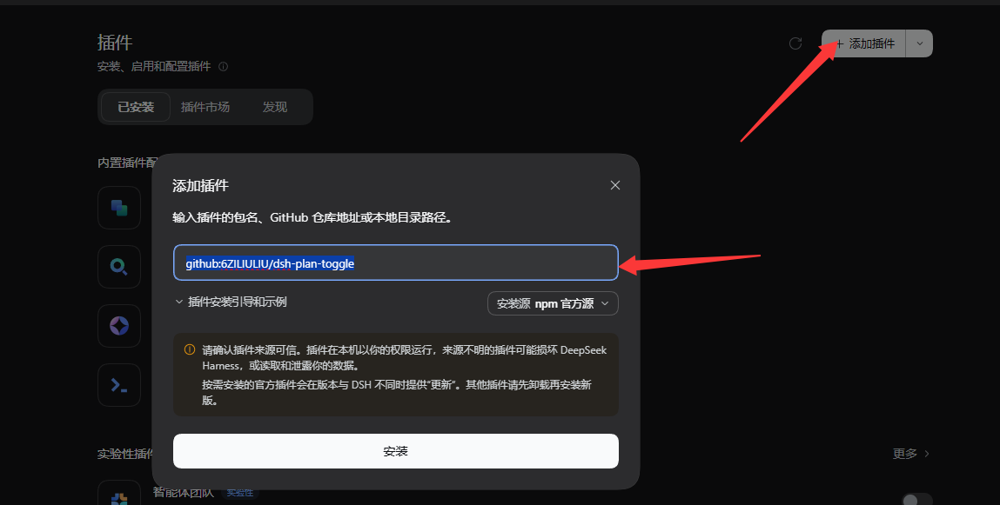

# dsh-plan-toggle

DeepSeek Harness plugin: two shortcuts and two composer buttons for working with
the `plan-mode` skill.

- **Toggle plan-mode in the draft** — adds or removes a `/plan-mode` line at the
  top of the composer draft, so the skill is carried for exactly this turn.
- **Send implement plan** — sends `implement plan` straight to the session,
  without touching your draft.

## 关于 plan-mode skill 的来源

本仓库内置的 `plan-mode` skill **复刻自 Codex 的计划模式**。它的流程编排条理清晰——先只读摸清事实，再确认意图，然后锁定实现，最后才输出计划——比一般"写个计划"的提示词可靠得多，所以把这套做法搬了过来，并接上 DSH 的 skill 机制与两个快捷入口。

## Install

打开**添加插件**窗口，把下面这串地址复制进去即可安装（指向本仓库的 GitHub 源 `6ZILIULIU/dsh-plan-toggle`）：

```
github:6ZILIULIU/dsh-plan-toggle
```



## 键位

| 端 | 切换 plan-mode skill | 发送 implement plan |
| --- | --- | --- |
| Desktop（Windows / macOS / Linux） | `Alt+P` | `Alt+I` |
| Web（Windows / macOS） | `Ctrl/Cmd+Shift+P` | `Ctrl/Cmd+Alt+I` |

不想记快捷键就用鼠标：输入框左侧有**「计划」**按钮，右侧有**「开工」**按钮，行为与快捷键一致。

### 切换 plan-mode skill（Alt+P）

按一下，当前会话的输入框里：

- 没有 `/plan-mode` 这行 → 插到最前面，后面带一个空格，可直接接写需求；
- 已有这行 → 删掉，其余内容原样保留。

**开关状态就是那行字本身**——看得见、改得动、随时可撤销。

```
/plan-mode 
帮我重构这个模块
```

发出去，这一轮就带上 skill 的规划流程。

### 发送 implement plan（Alt+I）

计划看过了、决定开工，按一下直接发出 `implement plan`，不用打这行字。

**不碰草稿**：走的是 `conversation.sendSession`，和 composer 发送同一条宿主路径，但不读取、不覆盖、不恢复草稿。你正在写的东西原封不动留在输入框里。

草稿处于提交中时按键放行，不会重复发送。

## 装了什么

一个 bundle，两个半边：

- **客户端**（`lib/client.js`）：一个插件行 `toggle-plan`，提供两个快捷键和两个输入框按钮。
- **宿主端**（`lib/index.js`）：通过 `ctx.skills.register()` 注册 `plan-mode` skill 本体（复刻自 Codex 的计划模式）。**装了这个包就有 `$plan-mode`，不需要在 `~/.agents/skills/` 下另放一份。**

> **skill 正文的权威版本在本仓库的 `lib/index.js`**。`ctx.skills.register` 注册在 profile 根作用域，属于全局 skill；runtime 注册的优先级（250）高于文件系统 provider（600），因此它会**遮蔽**同名的磁盘 skill。以后改 skill 内容请改这里，改 `~/.agents/skills/plan-mode/SKILL.md` 不会生效。

> 客户端插件是**单个自包含 bundle**：模块表只认平台 seed（`react` 等）、已物化模块或已注册的包工厂，包内相对路径 `require("./x")` 不可用。所有客户端代码因此集中在一个 `lib/client.js` 里，不要拆文件。

## 卸载

```
plugin_manager remove_bundle → dsh-plan-toggle
```

会同时移除快捷键、按钮和注册的 `plan-mode` skill。

## 键位自定义

设置 → 快捷键，搜索 “plan-mode” 或 “implement plan” 即可改键。

## 边界

- **不写磁盘**：不改任何文件、不改配置；skill 以 runtime 方式注册，不落盘。
- **skill 全局生效**：根作用域注册，所有预设的会话都能用。
- **不影响其他会话草稿**：快捷键与按钮只作用当前主视图那个会话。
- **不切换原生 plan 模式**：与 `/plan` 那套机制无关。
- **不误伤正文**：只有独占一行的 `/plan-mode` 才算标记；正文里提到它（如「请用 /plan-mode 规划」）不会被当成开关。
- **不吞草稿**：发送 implement plan 完全不经过草稿，原内容保留。

## License

MIT
